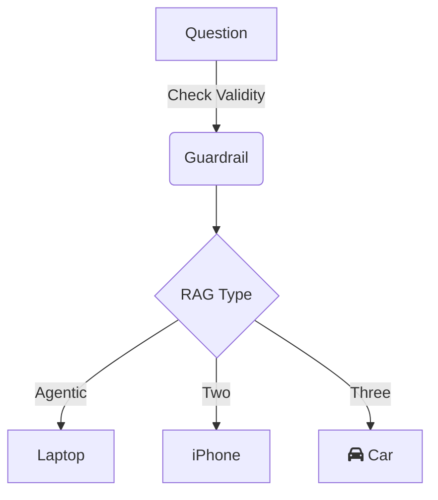

# Title

## Problem

## Solution

## Diagram

## Metrics

| Metrics   | micro | macro |
|-----------|-------|-------|
| Precision |       |       |
| Recall    |       |       |
| F1        |       |       |

## How to Run

## How to Contribute
