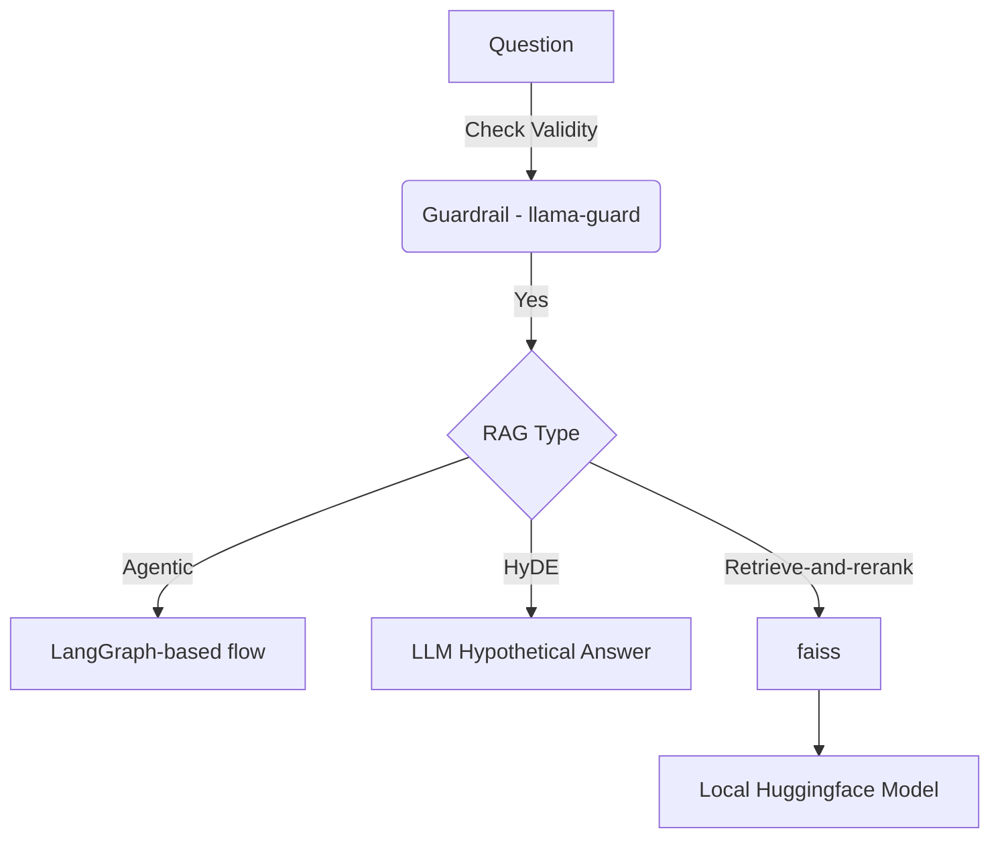

# RAG in Legal Document

## Masalah
Legal document has many format

## Solusi
This application can take many format of legal documents (i.e. .docx, .pdf, .tiff)

## Diagram

## Metrik

## Cara Menjalankan
