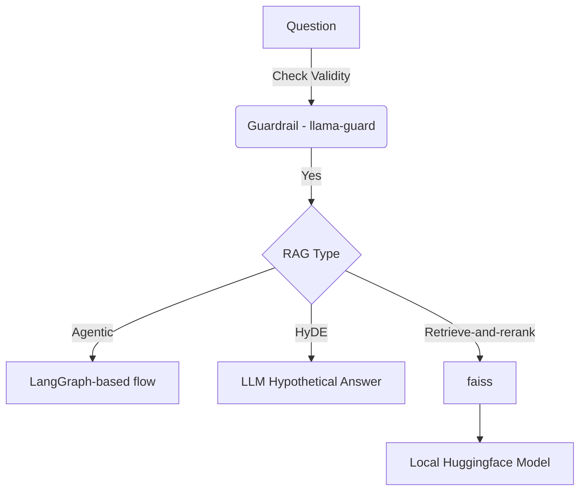

# RAG in Legal Document

## Masalah
Legal document has many format

## Solusi
This application can take many format of legal documents (i.e. .docx, .pdf, .tiff)

## Diagram



## Metrik

| Metrics   | micro | macro |
|-----------|-------|-------|
| Precision |       |       |
| Recall    |       |       |
| F1        |       |       |

Recall can be adjusted by using chunk limit 5 to 10 to make answer has more grounded chunks

## Cara Menjalankan

Require python >= 3.10

```bash
pip install -r requirements.txt
python app.py
```
